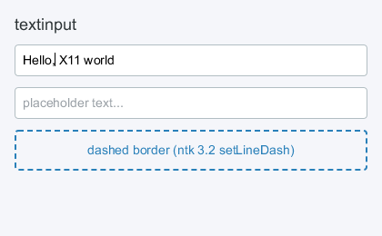
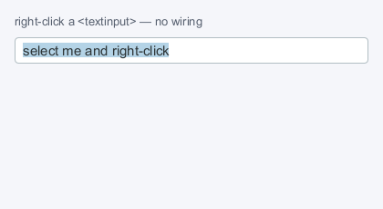

# Elements

Only `<window>`, `<popup>`, `<glarea>` and `<foreign>` are backed by real
windows of the display system. Everything else is a retained lightweight
node — one [yoga-layout](https://www.yogalayout.dev/) node each — painted
into the owning window's double-buffered 2d context on ntk's frame clock.

## `style` and props

Everything CSS has a concept for goes in **`style`**; everything else is a
prop. No name means both, which is why `<window width>` is unambiguously the
real window's geometry. See [styling.md](styling.md) for arrays, state
blocks and `createStyles`.

```jsx
<box style={{ flexDirection: 'row', gap: 8 }} onClick={pick}>
  <text style={{ fontSize: 14, color: '#2d3436' }}>hello</text>
</box>
```

## Layout properties (all drawn elements + windows)

Lengths are logical pixels — a number, or `'12px'` — and `'50%'` / `'auto'`
pass through to yoga where it takes them. `em`, `rem`,
`vw`/`vh`/`vmin`/`vmax` and `calc()`/`min()`/`max()`/`clamp()` resolve to
pixels for their node, and again when what they are relative to changes; a
CSS unit react-x11 does not read (`ex`, `cqw`, `pt`) is an error naming it.
CSS's shorthands are read too — `padding: '8px 16px'`,
`border: '1px solid $border'`, `inset: 0`
([styling.md](styling.md#lengths-and-shorthands)).

- **Size**: `width`, `height`, `minWidth`, `minHeight`, `maxWidth`,
  `maxHeight`, `aspectRatio`. `<image>` and `<svg>` keep their aspect ratio
  when only one of `width`/`height` is given
- **Flex**: `flexDirection` (`row`, `column`, `row-reverse`,
  `column-reverse`), `justifyContent` (`flex-start`, `center`, `flex-end`,
  `space-between`, `space-around`, `space-evenly`), `alignItems`,
  `alignSelf`, `alignContent`, `flexWrap`, `flex`, `flexGrow`, `flexShrink`,
  `flexBasis`, `gap`, `rowGap`, `columnGap`
- **Position**: `position` (`relative`, `absolute`, `static`, `sticky`, or
  one registered with `registerPosition`), `top`, `right`, `bottom`,
  `left`, `start`, `end`, and `inset` for all four. Under `sticky` the
  insets are how close to the nearest scroll pane's edges the box may come,
  not offsets — see [styling.md](styling.md#sticky-positioning) and
  [custom positions](styling.md#custom-positions)
- **Grid**: `display: 'grid'` arranges the children as a CSS grid —
  `gridTemplateColumns`, `gridTemplateRows`, `gridTemplateAreas`,
  `gridAutoColumns`, `gridAutoRows`, `gridAutoFlow` and `justifyItems` on
  the box, `gridColumn`, `gridRow`, `gridArea` and `justifySelf` on a child
  — see [styling.md](styling.md#grid)
- **Arrangement**: `layout` (`grid`, `masonry`, `equal-row`, or one
  registered with `registerLayout`) arranges the children in place of
  flexbox, and a child's `layoutItem` is what it tells that layout — see
  [styling.md](styling.md#custom-layouts)
- **Spacing**: `margin`, `marginTop/Right/Bottom/Left`, `padding`,
  `paddingTop/Right/Bottom/Left`, and the logical pairs `paddingInline`,
  `paddingBlock`, `marginInline`, `marginBlock`. `margin` and `padding` take
  CSS's one-to-four values as one string: `'0 auto'`, `'8px 16px'`
- **Visibility**: `display` (`flex`, `grid`, `none`), `overflow` (`visible`,
  `hidden`, `scroll`)

### Everything shrinks, nothing shrinks to nothing

`flexShrink` is `1`, as in CSS, but **an item never shrinks below what is
inside it**: every item has a floor of its own min-content size (CSS's
`min-width: auto` on a flex item). A row of chips squeezes until it wraps; a
label squeezes to its longest word; a `height: 40` row stays 40 tall. To say
otherwise:

| write                             | to mean                                   |
| --------------------------------- | ----------------------------------------- |
| `flexShrink: 0`                   | never give up any space at all            |
| `minWidth: 0` / `minHeight: 0`    | this may shrink past its content, to zero |
| `overflow: 'hidden'` / `'scroll'` | the same, and clip what no longer fits    |

The last two are CSS's own rule, and why a `<box overflow="scroll">` — a
viewport smaller than its content — gets `minWidth: 0` and `minHeight: 0`
for free.

One deliberate difference from CSS: **a size that was named is kept**. CSS
floors an item at `min(the size it was given, its content)`, so an empty
`height: 40` box squashes to nothing in a column too short for it; here it
stays 40. Say `minHeight: 0` to get CSS's answer.

### `flex`, the shorthand

`flex: 1` is `{ flexGrow: 1, flexShrink: 1, flexBasis: 0 }` — "take this
share of what is left, from a base size of nothing" — the right thing for a
pane that should fill its window rather than its content. `flex: 'auto'`
grows and shrinks from the content's own size, and `flex: 'none'` does
neither. CSS's long form reads too — `'1 1 0'`, `'0 0 240px'`,
`'2 200px'`. A longhand written beside it wins, so
`{ flex: 1, flexBasis: 'auto' }` reads the way it does in CSS.

## Paint properties

- `backgroundColor` — any CSS color string (`'#2980b9'`,
  `'rgba(0,0,0,.5)'`, `'red'`); `background` sets it and a gradient
  (`backgroundImage`) in one
- any colour may be `'currentColor'`, the node's ink — its own `color` or
  the one it inherits, followed when it moves
  ([styling.md](styling.md#currentcolor))
- `borderWidth`, `borderColor`, `borderRadius`, `borderStyle`
  (`'solid'` default, `'dashed'`), or `border: '1px solid $border'` for the
  first three — `border: '1px solid'` is drawn in `currentColor`
- per-side borders: `borderTopWidth`/`Right`/`Bottom`/`Left` override
  `borderWidth`, `borderTopColor`/… fall back to `borderColor`, and
  `borderBottom: '1px solid $border'` sets one side's pair — a blockquote's
  bar is `borderLeftWidth: 3` on the quote box, a table rule
  `borderBottomWidth: 1` on the row. `borderRadius` requires uniform
  borders; a non-uniform border paints square
  ([styling.md](styling.md#per-side-borders))
- `zIndex` — paint/hit order among siblings (stable sort)
- `objectFit` — where an `<image>`'s or a `<video>`'s picture goes in its
  content box, CSS's `object-fit`, centred: `'fill'` (`<image>`'s default),
  `'contain'` (`<video>`'s), `'cover'`, `'none'`, `'scale-down'`
- `outlineWidth`, `outlineColor`, `outlineOffset` — the focus ring, painted
  outside the border box and invisible to yoga, so it never moves what it
  surrounds. A focusable node draws one on `:focus-visible` unasked;
  `outlineWidth: 0` — or `outline: 'none'` — opts out
  ([styling.md](styling.md#the-focus-ring))
- `opacity` — how opaque the node is **with everything inside it**, 0 to 1:
  the subtree is drawn once and composited at that alpha, so a card, its
  icon and its text fade as one. `0` draws nothing and is still hit
  ([styling.md](styling.md#opacity))
- `transition` — `120`, or `{ backgroundColor: 120, left: 200 }`: how long a
  change to that property takes ([styling.md](styling.md#transitions))
- any value may be a **theme token**: `'$panel'` resolves against the nearest
  `theme` prop above the node ([styling.md](styling.md#theme-tokens))
- `'@width >= 600'` blocks restyle for the window's size, layout included
  ([styling.md](styling.md#window-size-queries))

`cursor` (`'pointer'`, `'text'`, `'wait'`, `'move'`, `'crosshair'`, resize
arrows, … — ntk's cursor names) and `pointerEvents` are style too.
`pointerEvents: 'none'` takes a node and its subtree out of hit testing;
`'box-none'` (React Native's) takes out only the node itself — its children
still take the pointer, and a press on its own area goes to what is behind:
the value for an overlay of controls, a `<glarea>`'s children included, that
must not swallow the clicks between them. So is `hitSlop`:

```jsx
<box style={{ height: 16, hitSlop: { top: 4, bottom: 4 } }} /> // 24px target
```

`hitSlop: 4` grows every side, the object form only the sides it names. It
affects **hit testing only** — not paint, not layout — so a 16px control
can take the 24px target WCAG 2.2 SC 2.5.8 asks for without misaligning its
row. Where slop overlaps a sibling, the one painted on top wins.

## Interaction props

`focusable`, `tabIndex` (sequential focus order; `-1` is focusable but not
tabbable), `autoFocus`, `trapFocus` (own a focus scope — Tab and presses
stay inside it, focus is restored when it unmounts), `disabled` (never
focusable, and the trigger for a `:disabled` style block), and the event
handlers listed in [events.md](events.md).

`onLayout` reports layout: `{x, y, width, height}` in logical pixels, the
position within the parent _as laid out_ (a scroll does not fire it), after
the first layout and then on each change. It arrives after the pass, so
setting state from it is safe. Use it when the reaction to a size is not a
style ([react-features.md](react-features.md#measuring-a-node)); when it
is, a `'@container'` block answers in the same frame
([styling.md](styling.md#container-queries)).

`role` and the `aria-*` props are read by the built-in AT-SPI bridge so
screen readers see the tree; inert where no assistive technology listens,
with sensible defaults per element ([accessibility.md](accessibility.md)).

`dropAccept` + `onDrop` accept a drop and `draggable` + `dragData` start
one, with other applications as well as inside the app; the props alone
register the node ([drag-and-drop.md](drag-and-drop.md)).

`selectable` makes an element a **selection surface** — see
[Selecting text](#selecting-text).

`scale` zooms a subtree like CSS `zoom`, not a transform: every length under
the element, and its own style, is multiplied, and text is shaped at the
drawn size — what an element owning a viewport (a graph pane, a map) mounts
its content inside. Windows take no `scale`
([scale.md](scale.md#a-subtree-of-its-own)).

---

## `<window>`

A real toplevel window — an X11 window, or an `NSWindow` on the Cocoa
backend; the flex, paint and event root for its subtree.

| prop                        |                                                                                                               |
| --------------------------- | ------------------------------------------------------------------------------------------------------------- |
| `title`                     | window title (UTF-8, `WM_NAME` + `_NET_WM_NAME`)                                                              |
| `width`, `height`, `x`, `y` | geometry, not yoga style; a size is pixels or `'auto'` (default, [below](#natural-size))                      |
| `backgroundColor`           | full-window clear color (default white)                                                                       |
| `onResize(ev)`              | the geometry changed; the tree reflows itself. Fires for **moves** too                                        |
| `onExpose(ev)`              | after a repaint was required                                                                                  |
| `onCloseRequest(ev)`        | WM close button; replaces the default answer                                                                  |
| `states`                    | EWMH `_NET_WM_STATE`, controlled                                                                              |
| `fullscreen`, `alwaysOnTop` | boolean sugar for two of those states                                                                         |
| `decorations`               | `false` asks the WM for no titlebar or border                                                                 |
| `transparent`               | 32-bit ARGB visual: rounded, translucent windows                                                              |
| `transientFor`              | ICCCM `WM_TRANSIENT_FOR`: the window this one belongs to                                                      |
| `onStatesChange(states)`    | what the window manager actually did                                                                          |
| `onClientMessage(ev)`       | a ClientMessage addressed to this window — EWMH, XEmbed, the tray                                             |
| `theme`                     | palette `$token` style values resolve against, for this subtree                                               |
| `embeddable`                | never maps itself; an embedder ([`<foreign>`](embedding.md)) does. Set by a [`<Frame>`](frame.md) pane's root |
| `hidden`                    | realized and laid out, never mapped while true                                                                |
| `frameRate`                 | frame pacing: `'display'` (default), `'adaptive'`, `'throughput'`, fps, `{ budget, minFps, maxFps }`          |

Each is described below. A geometry change sends only what changed, so a
new size leaves the window where the window manager or the user put it.
Windows may be nested (real X11 child windows). **Ref**: the live window —
on X11 the ntk `Window`, with `getContext('2d')`, `requestAnimationFrame`,
`setCursor` and the rest of the ntk API.

#### On the Cocoa backend

Everything about _drawing_ works — geometry, background, resize, close,
`transparent`, `theme`, `frameRate`, `hidden`. What a **window manager**
does differs, since macOS has none:

| prop                                              | on Cocoa                                                                                                      |
| ------------------------------------------------- | ------------------------------------------------------------------------------------------------------------- |
| `minWidth`/`minHeight`/`maxWidth`/`maxHeight`     | honoured                                                                                                      |
| `resizable`, `decorations`                        | honoured, but read **once, at creation**                                                                      |
| `transparent`, `borderRadius`                     | always available: every window composites                                                                     |
| `states: ['demands_attention']`                   | the Dock bounce, held until the state is removed                                                              |
| `fullscreen`, `states: ['maximized' \| 'hidden']` | the full-screen Space, the zoom, the Dock                                                                     |
| `onStatesChange`, `useWindowState()`              | fire for full screen (from the transition's start), zoom, Dock, key window; `desktop`/`obscured` never change |
| `embeddable`                                      | a `<Frame>` pane, through shared surfaces ([frame.md](frame.md))                                              |

**Inert** — accepted and, today, silently ignored, so shared code stays
branch-free: every other `_NET_WM_STATE` (`sticky`, `below`,
`skip_taskbar`, `shaded`, …), `appId`, `windowType`, `gravity`, the
increment and aspect hints, and `transientFor` (a managed `<Dialog>` already
floats on its own window). `onClientMessage` never fires. Why:
[macos.md](macos.md#windowing-semantics-what-maps-what-bends-what-breaks).

### Natural size

A window with no `width`/`height` is **sized from its content and capped at
the screen**. `'auto'` says so explicitly, per axis:

```jsx
<window title="prefs" />                               {/* natural, both ways */}
<window width={600} height="auto" />                   {/* height follows the content */}
<window width="auto" maxWidth={720} minHeight={200} /> {/* auto within your own bounds */}
```

This is CSS's shrink-to-fit — a top-level window has nothing to stretch
into; stretching into the screen is `fullscreen`. The size is worked out
before the window is created, so it never appears at the wrong size.

**How it is measured** — the second step is where the surprises are:

1. The tree is laid out with no available width, so nothing wraps and the
   root reports its **max-content** width.
2. That is clamped into `[minWidth, min(maxWidth, the screen)]` — the size
   hints bound the auto size as `min-width`/`max-width` bound `width: auto`;
   `minWidth` wins a conflict.
3. The tree is laid out **again at that width**, and the height comes from
   there: a paragraph that had to wrap is taller than step 1 said.

Unlike in CSS, the screen cap beats min-content: what does not fit is cut.

**The cap** is the usable area of the monitor the window opens on — its
Xinerama rect less the panels in `_NET_WORKAREA` — read once while
`createRoot()` connects; the screen on a server with neither; none in the
headless mock. The window manager's frame is not counted, so a window at
the cap is a titlebar too tall and the WM trims it.

**Afterwards, auto follows the content**, growing and shrinking with it,
until the user resizes the window or the window manager imposes a size;
then the window is theirs. A numeric `width` does the same, and `'auto'`
again hands it back. The window's own resize requests coming back are not a
takeover.

On X11 a re-fit is laid out once, at the new size: the frame waits for the
server to apply it (up to 150 ms, if the window manager refuses), so grown
content is never drawn cut off; the old pixels stay up meanwhile.
`REACT_X11_NO_REFIT_HOLD=1` turns the wait off
([debugging.md](debugging.md#react_x11_no_refit_hold1)). On Cocoa a window
is a whole number of **points**, rounded up (100.5 makes 101), and still
follows its content.

- A scroll container reports its **content** height, so an auto window
  around a long list opens screen-tall. Give the window a `height`, or the
  scroller a `maxHeight`.
- An auto width is the **unwrapped** row, so it depends on the UI font.
- A window tracking its content costs an extra layout pass on each frame
  that lays out; one with both sizes given pays nothing.

### A floor the content decides

`minWidth`/`minHeight` also take `'auto'`: **the smallest size the content
can be drawn at**, measured and handed to the window manager so the user
cannot drag the window below it. Opt-in — Qt and GTK do it by default —
since CSS lets content overflow.

```jsx
<window minWidth="auto" minHeight="auto">   {/* never smaller than my content */}
<window width={900} minWidth="auto" />      {/* my opening size, the content's floor */}
```

**How the floor is measured**: the tree is laid out with _no room at all_,
and the floor is how far it still reached. Each node contributes what its
own style lets it shrink to:

| the node                          | contributes      |
| --------------------------------- | ---------------- |
| a box that named a size           | that size        |
| a wrapping row                    | its widest item  |
| text                              | its longest word |
| `overflow: 'scroll'` / `'hidden'` | nothing          |
| a `minWidth: 0` of its own        | nothing          |
| a `minWidth: 240` of its own      | 240              |

A registered element contributes its `measureContent` answer for the
smallest size ([extending.md](extending.md#a-size-of-your-own)). This is
every node's own floor
([above](#everything-shrinks-nothing-shrinks-to-nothing)) read at the root,
with the same escape hatch: a node that names a floor of its own stops its
contents counting, so a window around a scrolling pane is floored by
everything _except_ that pane.

`maxWidth`/`maxHeight="auto"` mean **the size the content wanted** — the
natural size, not the floor. Where nothing can shrink they are equal, so
`minWidth="auto" maxWidth="auto"` is a fixed-size dialog, as is
`resizable={false}`.

- **A floor is a request.** mutter, kwin and xfwm enforce it at the drag; a
  tiling window manager may not, and the renderer will not fight it — clip
  gracefully anyway.
- **`minHeight="auto"` is for the current width**, re-sent as that changes:
  a paragraph is tallest at its narrowest.
- **The floor outlives the size.** An `'auto'` size stops tracking once the
  user takes over; an `'auto'` bound does not. It costs a layout pass per
  axis on frames that lay out, and is sent only when it moves.

### `hidden` — realized, laid out, not on screen

```jsx
<window hidden={minimized} title="scratch" />
```

The window exists at its (measured) size with a live tree, but is not
mapped while `hidden`; clearing it maps the window where it stands. Nothing
unmounts, so state, subscriptions and the window survive — declarative
"minimize by unmapping", and how [`Tooltip`](components.md#tooltip)
measures a label before placing it.

`<Activity mode="hidden">` or a suspended `<Suspense>` compose with it: the
window shows only while **neither** hides it. Hiding releases the keyboard
focus inside ([focus-follows-visibility](events.md)); the reveal restores it
unless something else took it. On a managed `<window>` hiding is ICCCM's
_withdraw_, so on reveal the window manager may frame or place it anew, and
`states` are re-applied rather than remembered; a `<popup>` just unmaps and
maps.

### `frameRate` — pacing the frames under a flood

```jsx
<window frameRate="adaptive">…</window>
```

By default a window paints every frame the clock gives it — on X11 as often
as the server keeps up, on macOS at the display's rate — right for a UI
answering input. For content that changes faster than anyone reads — a
terminal under `cat`, a socket-fed chart, a simulation — most of the JS
thread then goes to frames nobody sees, starving the producer.

`frameRate` prices frames in CPU time. Under `'adaptive'` painting may take
a quarter of the wall time while busy: credit accrues at that rate, each
frame spends what it cost (the flush, and on macOS the present), and a frame
claimed in debt waits until the credit is back to zero. So:

- **Idle is immediate**: the first frame after a pause paints on the next
  tick, whatever the last cost.
- **Cheap is unthrottled**: a frame cheaper than its credit is never held,
  so a blit-scrolled list keeps the display's rate.
- **A rare expensive frame is free**: the bucket holds a 50ms burst. A
  _stream_ of them waits `cost × (1/budget − 1)` each — 18ms after a 6ms
  frame.
- **A flood that ends is unthrottled at once**: the debt never exceeds one
  frame's cost.

`minFps` bounds staleness: the screen is never more than `1000 / minFps` ms
behind the last paint. `maxFps` caps the rate, cheap frames included.

| value                        | `budget` | `minFps` | `maxFps` | when                                                      |
| ---------------------------- | -------: | -------: | -------: | --------------------------------------------------------- |
| `'display'` (the default)    |        1 |     none |     none | a UI answering input: every frame, after React's batching |
| `'adaptive'`                 |     0.25 |       20 |     none | fed off an input path: a terminal, a live chart           |
| `'throughput'`               |      0.1 |       10 |       30 | output over display: may lag up to 100ms during a flood   |
| a number, `60`               |        1 |     none |       60 | a ceiling and nothing else                                |
| `{ budget, minFps, maxFps }` |          |          |          | any subset; the rest are `'display'`'s                    |

A budget below 1 with no `minFps` warns in development: nothing would bound
the wait after an expensive frame.

Precedence: **`REACT_X11_FRAME_RATE`** (`adaptive`, `display`,
`throughput` or a number) overrides everything, so an A/B run needs no code
change; then **the prop**; then **`createRoot({ frameRate })`**, the
default for every window of that root; then `'display'`. A `<popup>` takes
its own prop the same way; a [`<glarea>`](#glarea) takes its window's unless
it names one.

The pacer never changes what is painted (held damage accumulates into the
next frame) and never delays the answer to input: a click or key paints at
once ([events.md](events.md)). It prices JS-thread time only, so on X11 it
rarely holds a frame, and it is inert where a backend has backpressure of
its own. `REACT_X11_TRACE=requests` prints `waited=` on each held frame
([debugging.md](debugging.md)). Design notes:
[frame pacing](../design/architecture/frame-pacing.md).

### `onResize` fires for moves

`onResize` reports _any_ geometry change: under a window manager that moves
windows opaquely, a title-bar drag fires it per pointer step at the same
size. The renderer spends nothing on a move; a handler should check which it
got:

```jsx
<window
  onResize={(ev) => {
    if (ev.resized) refit(ev.width, ev.height);
    if (ev.moved) rememberPosition(ev.x, ev.y);
  }}
/>
```

`ev.previous` is the geometry these compare against. Once a reparenting
window manager has framed the window, `ev.x`/`ev.y` are frame-relative, not
screen coordinates.

### Stacking

Nested `<window>`s stack like drawn siblings — later on top, `zIndex` over
document order — and reordering them in JSX restacks the real windows.
Top-level windows are the window manager's to stack, so their tree order
means nothing; use `alwaysOnTop`.

```jsx
<window>
  <window key="back" /> {/* bottom */}
  <window key="front" /> {/* on top */}
  <window key="always" zIndex={1} /> {/* above both, wherever it sits here */}
</window>
```

### Window manager hints

Read by the window manager, applied at mount and on update (unchanged
values are not re-sent):

- `resizable={false}` pins min and max size to the current size.
- Size hints: `minWidth`, `minHeight`, `maxWidth`, `maxHeight`, `widthInc`,
  `heightInc`, `baseWidth`, `baseHeight`, `minAspect`, `maxAspect`,
  `gravity`.
- `appId`: `'instance'`, `['instance', 'Class']` or `{instance, class}`.
- `windowType`: `'dialog'`, `'utility'`, `'tooltip'`… or an array of
  fallbacks.
- `decorations={false}` asks for no titlebar or border.

```jsx
<window width={400} height={300} resizable={false} windowType="dialog" />
<window width={400} height={300} minWidth={320} minHeight={200} />
<window width={400} height={300} minWidth="auto" /> {/* measured — see above */}
```

On a `<window>` these names are the window's, not yoga's: `width`/`height`
are the real geometry the user can drag, `minWidth`/`maxHeight` what the WM
enforces, and the _contents_ are laid out by `style`. The four bounds also
take `'auto'` ([a floor the content decides](#a-floor-the-content-decides)),
and on an auto-sized window they bound the natural size, so
`<window resizable={false} windowType="dialog" />` is pinned at its measured
size — the fixed-size dialog.

### `transientFor` — a window that belongs to another

Without it, a secondary window is an unrelated application to the window
manager: its own taskbar and alt-tab entry, placed anywhere, stacked
independently, not minimised with its owner.

```jsx
const main = useRef(null);

<window ref={main} title="editor">…</window>
<window transientFor={main} windowType="dialog" title="Preferences">…</window>
```

Takes a ref to a `<window>`/`<popup>` or to **any drawn node** (resolved to
its window, so an out-of-flow `<box>` in the owner is a good handle), a raw
XID, `'root'` (this client's whole window group), or `null` to clear. A ref
still null at mount — an owner mounted as a sibling in the same commit — is
retried next frame.

Set it **with** `windowType="dialog"`. Under EWMH a managed transient with
no type already is a dialog (kept out of taskbar and pager), but a `dialog`
with no owner has nothing to stack above or iconify with. Stacking above
the owner and iconifying with it are window-manager policy (quartz-wm does
neither). **Inert on override-redirect windows** — every `<popup>` by
default — which the WM never manages; ntk warns if asked.

`windowIdOf(refOrInstance)` is the same resolution: the XID, or null. An
xdg-desktop-portal `parent_window` is `` `x11:${id.toString(16)}` `` —
lowercase hex, **no** `0x`. Today's portal backends tolerate a prefix, so
the mistake goes unnoticed; Qt's parser returns 0 on failure, which would
mean a silently unparented, non-modal dialog. `useWindowId(ref)` is the
hook form, returning a getter like `useAnchor`.

`decorations={false}` writes `_MOTIF_WM_HINTS` (Mutter, KWin, Xfwm,
Openbox, i3); a window manager that ignores it decorates anyway.

### Closing a window

Every window the window manager manages advertises `WM_DELETE_WINDOW`, with
or without `onCloseRequest` — otherwise the close button would kill the
connection mid-frame, skipping effect cleanup. Windows the WM does not
frame (a child `<window>`, an override-redirect `<popup>`) do not; a
[managed `<popup>`](#a-managed-popup-is-a-dialog) does.

- **No `onCloseRequest`**: the **primary window** unmounts the tree and
  closes the connection — effects clean up and the process ends on a drained
  loop. Any other window refuses, with a dev warning.
- **`onCloseRequest`**: only your handler runs — `setOpen(false)` for a
  dialog, a "save your work?" prompt, `root.unmount()` to quit.

The primary window is the first top-level `<window>` that is not
`transientFor` another and has no `windowType`; a lone window is primary
whatever its type. Secondary windows refuse because closing a
`{open && <window/>}` behind React's back would leave a window the app
believes open and can never reopen. Give a dialog a handler:

```jsx
{
  showSettings && (
    <window
      title="Settings"
      transientFor={main}
      onCloseRequest={() => setShowSettings(false)}
    />
  );
}
```

### Window state

`states` is EWMH `_NET_WM_STATE`: `modal`, `sticky`, `maximized` (or
`maximized_vert`/`maximized_horz`), `shaded`, `skip_taskbar`, `skip_pager`,
`hidden`, `fullscreen`, `above`, `below`, `demands_attention`, `focused`.
`fullscreen` and `alwaysOnTop` are sugar for `fullscreen` and `above`,
unioned with `states`. On the [Cocoa backend](macos.md) `fullscreen` is the
full-screen Space, `maximized` the zoom, `hidden` the Dock, and
`demands_attention` bounces the Dock icon until the app is activated or the
state removed ([desktop.md](desktop.md)); the rest are inert.

```jsx
<window
  states={['skip_taskbar']}
  fullscreen={isFullscreen}
  onStatesChange={(states) => setFullscreen(states.includes('fullscreen'))}
/>
```

**Controlled, and diffed against the previous props** — not the window's
current state, which the window manager changes behind the app's back
(maximize, a hotkey leaving fullscreen, a tiling WM). A state is re-sent
only when the app changes it, so a WM that disagreed is not fought.
`onStatesChange` reports what the WM did; without it the property is not
watched. States are applied **before mapping**, so a window opens fullscreen
without flashing at normal size. On XQuartz, whose quartz-wm lacks
`_NET_WM_STATE_ABOVE`, `alwaysOnTop` uses Apple-WM window levels.

### `onClientMessage` — speaking a protocol of your own

ClientMessage carries nearly every X11 convention — EWMH requests, XEmbed,
the system tray, protocols between copies of one app. `onClientMessage`
gets every one addressed to this window:

```jsx
<window
  onClientMessage={(ev) => {
    if (ev.messageType !== '_NET_SYSTEM_TRAY_OPCODE') return;
    if (ev.data[1] === SYSTEM_TRAY_REQUEST_DOCK) dock(ev.data[2]);
  }}
/>
```

`ev.messageType` is the atom's **name** (no interning needed), `ev.atom` its
id, `ev.format` 8, 16 or 32, `ev.data` the payload at that width — 5, 10 or
20 values. No setup; a window without the prop pays nothing.

- **Order is preserved**, as chunked protocols need
  (`_NET_SYSTEM_TRAY_BEGIN_MESSAGE` then `_NET_SYSTEM_TRAY_MESSAGE_DATA`).
  `messageType` is `null` only for an atom the **server** does not know — a
  broken sender.
- **Scoped to the window the message names**, unlike
  `useApp().X.on('event')`, which sees every window's events and outlives
  the element. Messages to other windows, the EWMH ones sent to the root
  included, do not arrive; a window manager wants the raw stream
  (`examples/wm-core.js`).
- **`preventDefault()` stops react-x11's own handling** — today XDND, for a
  window speaking the drag protocol itself. The close button is
  `onCloseRequest`'s.

Send with `useApp().X.SendClientMessage(destination, aboutWindow, atom,
format, data, eventMask)`, or ntk's `window.sendClientMessage(name, data)`,
which interns the atom. EWMH messages _about_ a window go to the **root**;
to another application's window pass event mask `0`. Taking a selection
needs a timestamp, not `CurrentTime`:
[`lastInputTime` and `serverTime`](clipboard.md#owning-a-selection-of-your-own).

### Kiosk

No `kiosk` prop — it is a combination:

```jsx
<window
  fullscreen
  decorations={false}
  states={['above', 'skip_taskbar', 'skip_pager']}
  style={{ cursor: 'none', flexGrow: 1 }}
/>
```

`cursor: 'none'` hides the pointer; an unset `cursor` inherits the root
window's ([styling.md](styling.md)).

### `transparent` — rounded corners and translucency

`transparent` creates the window on a 32-bit ARGB visual: what the tree
leaves unpainted stays empty, and a compositor blends it with what is
behind. With `borderRadius` in the window's own `style` that gives rounded
corners with an **antialiased** edge (alpha, not a 1-bit Shape mask):

```jsx
<popup
  transparent
  grab
  style={{ backgroundColor: 'rgba(24, 24, 30, 0.86)', borderRadius: 14 }}
>
  …
</popup>
```

`backgroundColor` may be translucent; unset, the window is empty but for
what the tree paints. A window's `borderRadius` works **only** with
`transparent`; on an opaque window it is ignored (the corners would show
the server's white).

### When transparency is not available

**On the Cocoa backend it always is.** On X11 it needs a **depth-32
TrueColor visual** (XQuartz has none) and a **running compositor** (Mutter,
KWin, picom, …); without one, painted-away corners show **black**.
react-x11 prevents that: where transparency would not be seen, the window
is filled edge to edge, its `borderRadius` ignored and a translucent
`backgroundColor` flattened — square and opaque, with nothing asked of the
app. Design the other side with `'@supports transparency'`:

```jsx
<popup
  transparent
  style={{
    backgroundColor: '#1c1c22', // square and opaque, works everywhere
    '@supports transparency': {
      backgroundColor: 'rgba(24, 24, 30, 0.86)',
      borderRadius: 14,
    },
  }}
/>
```

The block ([Capability queries](styling.md#capability-queries)) is answered
per window and re-resolved live: a compositor started mid-session rounds the
popup without a remount, which is why `transparent` takes the 32-bit visual
even when nothing composites yet. `useSupports('transparency')` asks the
same of the display, before any window exists:

```jsx
const canBlend = useSupports('transparency');
const margin = canBlend ? 26 : 0; // room for a client-drawn shadow
```

`REACT_X11_NO_TRANSPARENCY=1` shows the fallback on a compositing display:
`transparent` is ignored and both answer false
([debugging.md](debugging.md)). Toggling `transparent` on a mounted window
does nothing until it remounts (change its `key`): the visual is fixed at
creation.

Input still hits the full rectangle — corners are invisible, not
click-through (the Shape input region is reachable through the ntk ref).
Child `<window>`s are composited by the X server, not the compositor, so a
transparent window nested in another blends against nothing.

## `<popup>`

An override-redirect top-level window at **screen coordinates** — menus,
tooltips, dropdowns — that the window manager ignores (no decorations, no
focus stealing). Its place in the JSX tree does not affect its place on
screen; it is its own paint and event root, and conditional rendering
controls its lifetime. `anchor` places it against a node
([below](#anchor--a-popup-that-places-itself)); `x`/`y` place it in screen
logical pixels, e.g. at `ev.screenX`/`screenY`. Same props as `<window>`,
**including [natural size](#natural-size)** — a menu sized by its rows.

| prop               |                                                                                                  |
| ------------------ | ------------------------------------------------------------------------------------------------ |
| `anchor`           | place against a node, a rect inside one, or a screen rect, at the content's size                 |
| `grab`             | hold a pointer grab while up — how menus behave on X (below)                                     |
| `grabKeyboard`     | take the keyboard while up — for a popover a tray click opened (below)                           |
| `transparent`      | rounded corners and translucency ([above](#transparent--rounded-corners-and-translucency))       |
| `onDismiss`        | a press landed outside the popup: close it                                                       |
| `trapFocus`        | own a focus scope: a modal ([events.md](events.md#focus-scopes-modals))                          |
| `overrideRedirect` | `false` makes it a WM-managed window — a real dialog (below)                                     |
| `dragPreview`      | a drag preview following the pointer, never a drop target ([drag-and-drop.md](drag-and-drop.md)) |

### `anchor` — a popup that places itself

```jsx
function Completions({ editorRef, caret, matches, onPick }) {
  if (!matches.length) return null;
  return (
    <popup
      anchor={{ to: editorRef, at: caret, placement: 'bottom' }}
      maxHeight={220}
    >
      <box
        style={{ overflow: 'scroll', padding: 4, backgroundColor: '$surface' }}
      >
        {matches.map((m) => (
          <box key={m.label} onClick={() => onPick(m)} style={{ padding: 6 }}>
            <text>{m.label}</text>
          </box>
        ))}
      </box>
    </popup>
  );
}
```

That is the whole completion list: **at the caret**, as wide as its widest
label, at most 220 tall and scrolling past that, flipped above the line near
the screen's bottom — no font measured, size stated or position named.

`anchor` takes [`anchorRect`'s options](components.md#useanchorref--anchorrectnode-options)
— `placement`, `align`, `offset`, `alignOffset`, `alignTo`, `at` — plus `to`,
the node (or a ref to one) it hangs off; `x`/`y` are ignored while it is
set. The popup is measured, placed (flip and screen-edge clamp depend on its
size) and only then created, so it appears at the right size in the right
place. It then follows everything that can move either half: the anchor's
layout, an ancestor scrolling, the owner window moving, its own content
growing.

`at` is a rect **inside** the node, in its coordinates —
`{ x: caretX, y: lineTop, width: 1, height: lineHeight }` — read by the
flip, the alignment and `offset` as a small widget there would be; `{x, y}`
alone is a point.

An anchor ref not attached yet (written _above_ its trigger) is waited for,
one frame, rather than opening at the screen corner. **When the anchor
scrolls out of view the popup unmaps**, and returns — re-taking its
`grab` — with the anchor; a real window cannot be clipped by the anchor's
ancestors. To _close_ it instead, place it yourself with
[`useAnchorTracking`](components.md#useanchorref--anchorrectnode-options)'s
`onOutOfView`.

A popup never takes the X input focus, but nodes in it can hold the **owner
window's** focus — with `trapFocus` and `autoFocus` that is a modal
([Focus inside a `<popup>`](events.md#focus-inside-a-popup)). One with no
owner window takes keys with `grabKeyboard`
([below](#a-popover-under-a-tray-item)).

**`grab` makes a menu dismissable.** Without it, a press elsewhere —
another app, the root window, even this app's own window frame (the window
manager's) — never reaches the client, and the menu stays open. With it the
press is redirected to the popup, lands outside it, and `onDismiss` fires.
The app's own windows still get their presses, so submenus and the owner
keep working; only a menu's root popup needs the grab. `Select`,
`ContextMenu` and `MenuBar` do this.

### A popover under a tray item

A tray click has no node: [`useTray`](desktop.md#the-tray)'s `onClick`
reports the item's screen frame. `anchor` takes it as `rect` instead of
`to`, with the same flip, clamp and natural size, kept on that monitor and
below the menu bar:

```jsx
function MenuBarApp() {
  const [open, setOpen] = useState(null);
  const close = () => setOpen(null);
  useTray({ icon: 'waveform', onClick: setOpen });
  if (!open) return null;
  return (
    <popup
      anchor={{ rect: open, placement: 'bottom', align: 'center', offset: 6 }}
      grab
      grabKeyboard
      onDismiss={close}
      onBlur={close}
    >
      <Controls onClose={close} />
    </popup>
  );
}
```

`rect` is logical screen pixels; `{ x, y }` alone is a point — all a
freedesktop tray reports. It moves only when replaced, and is never out of
view. Its monitor is the one the **whole rect** overlaps most (a menu-bar
item's frame starts above its display's top), else the nearest.

**`grabKeyboard`**: a menu-bar app has no window for keys to arrive
through, so the popup takes the keyboard while up:

| backend | what it is                                                                      |
| ------- | ------------------------------------------------------------------------------- |
| X11     | a keyboard grab, taken and dropped with the map, as `grab` is for the pointer   |
| macOS   | a key-capable window at the popup level, activating the app — `NSPopover`'s way |
| Wayland | nothing more: a grabbing popup has the keyboard already                         |

On macOS the window's kind is fixed at creation, so the prop does not change
on a mounted popup. The popover closes on `onBlur` there (another app takes
the key window) and on `onDismiss` on X; pass both.

**Shortcuts work with nothing passed**: a binding belongs to the top-level
`<window>`, or in an app without one, to the root-level `<popup>` holding
the keyboard. So do `useFileDialog`'s parent, the global menu and
`useWindowState`.

```jsx
function Controls({ onClose, onToggle }) {
  useAccelerator([['space']], onToggle);
  useAccelerator([['Escape']], onClose);
  return <box style={{ padding: 12, gap: 8 }}>…</box>;
}
```

A binding with neither a window nor a popup above it — above the
`if (!open)`, say — never fires; development says so once, and
[`scope`](events.md#accelerators) anchors one at a node you name.

### Centred over something

`placement: 'center'` puts the popup **over** its anchor, middle on middle,
clamped to the monitor. Over a window's rect it is a dialog —
[`Dialog`](components.md#dialog) passes its owner's screen rect as `rect`:

```jsx
<popup
  anchor={{ rect: ownerRect, placement: 'center' }}
  width={360}
  height="auto"
>
```

It is centred **once**: when its size changes later it keeps its top edge
and horizontal middle, moving only to stay on the monitor, so what the user
is reading does not jump. A managed one grows from wherever it was moved. A
new `rect`, or the `to` node moving, centres it again.

### A managed `<popup>` is a dialog

`overrideRedirect` defaults to `true` — what makes a menu a menu. `false`
hands the popup to the window manager: framed, titled, movable, with a
close button (`onCloseRequest`). With `transientFor` it is a real dialog,
above its owner, out of the taskbar and alt-tab, minimising with the owner.

```jsx
<popup overrideRedirect={false} transientFor={anchor} windowType="dialog"
       title="Preferences" trapFocus>
```

Turn `grab` off with it — a grab swallows the press that starts a WM drag —
so a press outside no longer dismisses it, as befits a dialog.
[`Dialog`](components.md#dialog) does this; `managed={false}` returns to
override-redirect.

`windowType` defaults to `"popup_menu"`; name yours (`"tooltip"`,
`"dropdown_menu"`, … — `Select`'s sheet and `Tooltip` do). It is
**additive**: the popup stays override-redirect, and compositors use the
type for consistent shadows and animations.

## `<box>`

The flex container. All layout + paint + interaction props above.
**Ref**: the retained node — `abs` (`{x, y, width, height}` within the
window, valid after layout). With `overflow: 'scroll'` it is also the
**scroll container**.

## Scrolling: `overflow: 'scroll'` {#scrolling}

There is no scrolling element: a `<box>` or `<window>` with
`overflow: 'scroll'` is a clipped viewport over its overflowing children, on
**both axes**:

```jsx
<box style={{ overflow: 'scroll', flexGrow: 1 }}>{rows}</box>
```

The wheel scrolls it; a draggable thumb is drawn on each overflowing axis.
`overflow: 'hidden'` clips without scrolling. Being a style, it toggles
without a remount (`overflow={dense ? 'scroll' : 'visible'}` keeps the node,
children and state); a box that stops scrolling resets its offset to 0, as
in CSS.

**It is a tab stop and takes keys** whenever it has somewhere to scroll, so
unfocusable content (a log, a long `<text>`) is readable without a pointer:

| key                 |                                      |
| ------------------- | ------------------------------------ |
| arrows              | one wheel notch (48px) on that axis  |
| PageUp / PageDown   | a viewport, keeping a sliver of it   |
| Space / Shift+Space | the same, for the hand already there |
| Home / End          | the top and the bottom               |

One that fits its content is no tab stop, takes no keys and no wheel: **the
wheel chains past it** to the next scroll container out. The keys are a
default action — your `onKeyDown` runs first, and `preventDefault()` cancels
them. A pane with an `onClick` pages with Space and activates with Enter
([events.md](events.md#space-and-enter-are-a-click)); a focusable row
_inside_ a pane takes both keys and pages with neither.

A press on the bar never reaches the row behind it. A thumb drag keeps its
grip; a track press pages towards it. Drags move by whole device pixels, as
the wheel does ([extending.md](extending.md#scrolling-content-you-painted)),
so nothing is drawn off the pixel grid. `<textarea>` behaves the same, and a
bar press there never moves the caret.

### The layout defaults it brings

| default                        | when                                     |
| ------------------------------ | ---------------------------------------- |
| `flexBasis: 0`                 | `flexGrow > 0` and no `width` / `height` |
| `minWidth: 0` / `minHeight: 0` | always                                   |

`min-*: 0` lets a viewport be smaller than its content; the zero basis is
half of `flex: 1`. Without them a header/scroll/footer window grows past its
bounds and pushes the footer out of view. An explicit value always wins.

### Props

| prop                |                                                                                  |
| ------------------- | -------------------------------------------------------------------------------- |
| `onScroll(ev)`      | `{scrollX, scrollY, contentWidth, contentHeight, viewportWidth, viewportHeight}` |
| `onViewport(ev)`    | `{width, height, contentWidth, contentHeight}` whenever they change              |
| `scrollbar={false}` | hide the drawn scrollbars                                                        |
| `scrollbarColor`    | thumb color                                                                      |

**Ref**: the node, plus `scrollTo` / `scrollBy` / `scrollIntoView(node)` /
`canScroll(dx, dy)` and `scrollX` / `scrollY` / `contentWidth` /
`contentHeight`. In TypeScript, `useRef<ScrollableNode>(null)` types them;
`DrawnNode` still works for a box you do not scroll.

`scrollTo(y)` scrolls vertically; `scrollTo({x, y})` either axis, leaving an
omitted one; `scrollBy` likewise. `canScroll(dx, dy)` says whether there is
room on the axis a delta names — what the wheel asks each node on its way
out, and what your own element implements
([extending.md](extending.md#scrolling-content-you-painted)).

Horizontal content comes from children that will not shrink (a row of
fixed-width cells). Its extent is measured **through the subtree**, like
`scrollWidth`: a row stretched to the viewport whose cells overflow it
still scrolls; a node clipping its own children ends the measurement. A
horizontal wheel axis scrolls sideways, as does **Shift + vertical
wheel**. With both bars, each stops short of the other's corner. Distances
are the device's: with XI2 a touchpad scrolls by the fraction of a notch it
measured. A wheel notch and an arrow key are 48 pixels
([events.md](events.md#wheel)).

`onViewport` fires from **layout**, so it arrives before anyone scrolls —
what a virtualized list (`Table`) needs to decide how many rows to build,
since an effect cannot read the size off the ref yet. `onLayout`
([Interaction props](#interaction-props)) is the same signal on any element,
without the content size.

`scrollIntoView(node)` scrolls the minimum on both axes to show a
descendant; one larger than the viewport gets CSSOM's `block: nearest`
(left alone if it covers the viewport, else brought in by the nearer edge).
It is safe right after the node mounts — it resolves on the next layout
pass — and a node already in view leaves the pane alone.

`scrollTo` answers inside the call from the last pass's extent: the offset
moves and `onScroll` fires before it returns. If a pass is owed, whatever
that extent could not satisfy is re-applied against the new content before
the frame paints, so restoring a position from a mount-time
`useLayoutEffect` shows it in the first frame, and `scrollTo(Infinity)` from
a layout effect in the commit that added rows shows the end in the first
frame that has them. `Infinity` means the end wherever the pass finds it
(as the End key does) — prefer it to `contentHeight`, the last pass's
measurement, which falls short when a commit adds more than a viewport. A
`scrollBy` before the pass continues from where the pass puts the pane.
Until then `scrollX`/`scrollY` read the call's answer; `onScroll` reports
the pass's afterwards.

`onScroll` fires for **every** offset change. Wheel, keys, bars and calls on
a laid-out pane report inside the call. Layout's own moves — a held
`scrollTo` landing, `scrollIntoView` resolving (focus on a row below the
fold), the clamp when content shrinks or the viewport grows — report after
the frame that shows them, only if the offset moved. The payload is read at
delivery, so a handler mirroring the offset into state ends where the pane
did.

### On a `<window>`

`<window style={{ overflow: 'scroll' }}>` scrolls the window's own content
with the same wheel, keys and bars; it stays a `frame` to a screen reader.
Its ref is still ntk's `Window`, so reach the scroll API through a ref on a
box inside it, or the node in `onViewport`.

## `<text>`

Shaped, wrapped text (bidi, ligatures, kerning, font fallback). Strings and
numbers are legal only inside `<text>`; nested `<text>`s are **style spans**
of one paragraph, wrapped as one.

| prop                                                |                                                        |
| --------------------------------------------------- | ------------------------------------------------------ |
| `color`                                             | text color — inherited (see below)                     |
| `fontSize`, `fontFamily`, `fontWeight`, `fontStyle` | ntk font style (fontconfig lookup + fallback)          |
| `fontVariationSettings`                             | a variable font's axes — see below                     |
| `textRendering`                                     | which glyph path to draw with — see below              |
| `letterSpacing`                                     | space after every character, in px — see below         |
| `fontVariantNumeric`, `fontFeatureSettings`         | figures and OpenType features — see below              |
| `textAlign`                                         | `left`, `right`, `center`, `start`, `end` (bidi-aware) |
| `lineHeight`                                        | multiplier over the natural font line height           |
| `textWrap`                                          | `wrap` (default) or `nowrap`                           |
| `maxLines`                                          | how many lines are kept — unlimited by default         |
| `textOverflow`                                      | `clip` (default) or `ellipsis`, for what was cut       |

The first four rows, `fontVariationSettings`, `textRendering`,
`letterSpacing` and the two feature properties **inherit**, into spans and
across `<box>`es alike
([styling.md](styling.md#inheritance-the-ink-the-face-and-the-size)); the
rest belong to the `<text>` that owns the box.

`{ textWrap: 'nowrap', textOverflow: 'ellipsis' }` is one line ending in
`…`; an ellipsis with no `maxLines` means one line. Only the pixels are cut
— the accessible name, caret indices and `textContent()` keep the whole
string
([styling.md](styling.md#keeping-text-on-one-line-and-saying-when-it-did-not-fit)).
A font file of the app's own opens with `loadFont`/`useFont`, which return
the family name for `fontFamily`
([styling.md](styling.md#a-font-file-of-your-own)).

`start`/`end` follow the box's **direction**, not the string's first strong
character: the paragraph is laid out at that base level, so `"(12) files"`
in an RTL panel punctuates as RTL, and text with no strong characters still
lands on the right side
([styling.md](styling.md#direction-and-the-logical-edges)).

### Variable fonts

`fontWeight` drives a variable font's `wght` axis, so one file serves every
weight, those between named instances included; `fontVariationSettings`
sets other axes by tag:

```jsx
<text style={{ fontFamily: 'Inter', fontWeight: 460 }}>
  Serious by default.
</text>
<text style={{ fontVariationSettings: { wdth: 87.5, slnt: -8 } }}>
  condensed
</text>
```

It inherits, and spans may override it. Unknown axes are ignored and values
clamped, so it is safe on any face; it compares **by value**, so a literal
is fine. Faces are instantiated on demand but never quantized: a slider
bound to an axis with `step={1}` asks for hundreds of faces as it drags —
step the control. Use the `.ttf`; a variable `.woff2` cannot be
instantiated (ntk's `docs/fonts.md`).

### `textRendering`

CSS's property: which glyph path draws the text.

| value                |                                                           |
| -------------------- | --------------------------------------------------------- |
| `auto` (default)     | ntk decides from the size — right for UI text             |
| `geometricPrecision` | glyph origins exactly where shaping asked; nothing cached |
| `optimizeSpeed`      | ntk's cached glyph bitmaps, at any size                   |
| `optimizeLegibility` | accepted, means `auto` — there is no hinting to turn on   |

```jsx
<text style={{ fontSize: 96, textRendering: 'geometricPrecision' }}>
  Serious by default.
</text>
```

The cached path puts each glyph on a whole pixel, so animating `wght` makes
single glyphs jump while neighbours stand still; `geometricPrecision`
places them where shaping asked, and the line slides. It inherits (a span
may override it) and **never reflows** — only draw-time rounding differs —
so it is safe to flip on a state change. It rasterizes outlines on every
draw and caches nothing: right for animated display text, wrong for a
static paragraph, hence `auto`.

### Letter spacing and figures

`fontVariantNumeric: 'tabular-nums'` gives every digit one width, so a
changing number (a readout beside a slider) stops shuffling its row; most
UI faces (SF Pro, Inter) default to proportional figures.

```jsx
<text style={{ fontSize: 30, fontVariantNumeric: 'tabular-nums' }}>
  {hz} Hz
</text>
```

Keywords are CSS's: `lining-nums`/`oldstyle-nums`,
`proportional-nums`/`tabular-nums`, `diagonal-fractions`/`stacked-fractions`,
`ordinal`, `slashed-zero` — several at once, one per pair
(`'tabular-nums slashed-zero'`); `'normal'` restores the face's own.

`fontFeatureSettings` takes any OpenType feature by tag: an array to turn
on, or an object of tag to on, off or alternate index. It wins where both
name a feature; missing features are ignored; it compares by value.

```jsx
<text style={{ fontFeatureSettings: ['tnum', 'zero'] }}>0.10</text>
<text style={{ fontFeatureSettings: { ss01: true, salt: 2 } }}>Rag</text>
```

`letterSpacing` is CSS's, in logical pixels, after every character (the
last on a line too); negative tightens. Spaced text drops the optional
ligatures (`liga`, `clig`, `dlig`, `hlig`) — name one in
`fontFeatureSettings` to keep it.

```jsx
<text style={{ fontSize: 11, fontWeight: 600, letterSpacing: 1.26 }}>
  NOISE TYPE
</text>
```

All three inherit, the two feature properties independently as in CSS (a
`fontVariantNumeric` below replaces the one above, leaving an inherited
`fontFeatureSettings` alone). All three re-measure on change, and none may
go in a state block.

### Tiny text

Text under **6 logical pixels** is painted as one strip of its ink per line
instead of glyphs — in a minimap, a zoomed-out graph or a grid of thousands
of cells, it is an illegible smudge anyway, and the strip costs one fill.
Layout is unchanged, and the size is logical, so it holds on a 2x panel.
`createRoot({ textStripBelow })` moves the threshold (`0` keeps glyphs at
every size); `REACT_X11_TEXT_STRIP_BELOW` sets it without `createRoot`.

## Selecting text

Labels are not selectable, as `Gtk.Label` is not: most desktop text is
chrome, and a stray drag lighting up a caption is noise. An element opts in:

```jsx
<box selectable style={{ padding: 12 }}>
  <text style={{ fontSize: 20, fontWeight: 'bold' }}>Release notes</text>
  <text>Everything below this heading can be dragged over and copied.</text>
</box>
```

It becomes a **surface**: a drag selects across all text under it, a double
click takes a word, a triple click a block, Ctrl+A the surface, Ctrl+C
copies. Releasing the button hands the text to **PRIMARY**, so a middle
click in a terminal pastes it ([clipboard.md](clipboard.md)); macOS has no
PRIMARY, so only a copy reaches the pasteboard
([clipboard.md](clipboard.md#primary-is-x11-only)).

### What is in a surface

Everything under it that answers for its own text, in document order:
`<text>`, and any element implementing the accessors in
[extending.md](extending.md#answering-for-your-own-text) — a terminal, log
view or code editor from outside this package joins the same drag, with no
registration. **Not** in it:

- anything under `selectable={false}` (CSS's `user-select: none`) — a
  list's bullets, a table's chrome, a caption inside a document;
- `<textinput>`, `<textarea>` and any element declaring `hasOwnSelection` —
  they keep their own selection, and a press in one is theirs;
- `<svg>`, and registered elements that draw text without exposing
  character geometry.

### What a copy assembles

Separators come from **layout**, not markup: text sharing a band of pixels
is joined with a **tab**, text starting below with a **newline** — cells and
rows for a table, a paragraph per line for prose. An item excluded with
`selectable={false}` is absent from the copy as from the highlight.

```jsx
// copies as "name\tsize\nnotes\t4 kB"
<box selectable>
  <box style={{ flexDirection: 'row' }}>
    <text style={{ width: 120 }}>name</text>
    <text>size</text>
  </box>
  <box style={{ flexDirection: 'row' }}>
    <text style={{ width: 120 }}>notes</text>
    <text>4 kB</text>
  </box>
</box>
```

### The props

| prop                    |                                                                                     |
| ----------------------- | ----------------------------------------------------------------------------------- |
| `selectable`            | `true` starts a surface; `false` opts a subtree out of the one above it             |
| `selectionColor`        | highlight behind selected text (default: theme's `selection`, a tint of its accent) |
| `onSelectionChange(ev)` | `ev.text` is what a copy would take; `ev.isCollapsed` whether it is empty           |

On the surface's node, through a ref: `selectAll()`, `clearSelection()`,
`selectedText()`, `setSelection(anchor, focus)` — each end
`{ node, index }`, indices in code points — and `textSelection`, a snapshot
of `{ isCollapsed, text, ranges }`.

### One selection, and where the keys go

**One selection is visible per application**: selecting in a document
collapses a field's highlight and vice versa — which keeps PRIMARY honest.

A surface is a **focus target** (Ctrl+A and Ctrl+C must arrive somewhere),
so it is in the Tab cycle; `tabIndex={-1}` removes it but keeps it
press-focusable — right for a document in a larger UI, wrong for a reader
whose window is the document. The pointer is an I-beam over it unless
`cursor` says otherwise. The selection reaches assistive technology through
`<text>`'s AT-SPI text interface
([accessibility.md](accessibility.md#text-controls)).

### The geometry underneath

Four accessors on every drawn node build the selection, and are public — a
caret rect is what an autocomplete popup anchors to
(`<popup anchor={{ to, at }}>`), a hit test turns a click into an offset:

```js
const node = paragraphRef.current;
node.textContent(); // 'Everything below this heading…'
node.textIndexAt(ev.x, ev.y); // 14 — window coordinates in, a code point out
node.textCaretRect(14); // { x, y, width: 0, height }
node.textRangeRects(4, 14); // the bands a highlight over [4, 14) fills
```

Indices are **code points**, not UTF-16 units. Rects are in the owning
window's device pixels, like `abs` and `contentBox()`; mouse `x`/`y` are
logical ([scale.md](scale.md)). `textRangeRects` returns a band per line
_and_ per direction run, since a range crossing from Latin into Arabic
covers separate stretches of pixels.

---

## `<textinput>`



Single-line editable text; caret and selection positions are exact across
kerning, shaping and trailing whitespace.

| prop                              |                                                                                                |
| --------------------------------- | ---------------------------------------------------------------------------------------------- |
| `value` + `onChange(ev)`          | controlled mode (display follows the prop)                                                     |
| `defaultValue`                    | uncontrolled mode                                                                              |
| `onSubmit(ev)`                    | Enter/Shift+Enter; with Ctrl, Alt or Super, a shortcut's ([events.md](events.md#accelerators)) |
| `name`                            | field name, echoed on the event                                                                |
| `placeholder`, `placeholderColor` | shown when empty                                                                               |
| `maxLength`                       | code-point limit                                                                               |
| `selectionColor`, `caretColor`    | selection/caret paint                                                                          |
| `inputMode`                       | IME hint: `numeric`, `decimal`, `tel`, `email`, `url` ([events.md](events.md#input-methods))   |
| text style props                  | as `<text>`                                                                                    |

The field follows its box's **direction** as `<text>` does: value,
placeholder and caret start at the base direction's start edge (the right
under `direction: 'rtl'`), the value is shaped at that base level, and
clicks, caret, selection and horizontal scroll mirror together
([styling.md](styling.md#inside-an-editable-field)).

### The change event

`onChange` and `onSubmit` get a synthetic event, not a bare string:

```jsx
<textinput
  name="email"
  value={email}
  onChange={(ev) => setEmail(ev.target.value)}
/>
```

| on the event                        |                                                     |
| ----------------------------------- | --------------------------------------------------- |
| `ev.value`, `ev.target.value`       | the text **after** the edit                         |
| `ev.name`, `ev.target.name`         | the `name` prop                                     |
| `ev.type`                           | `'change'` or `'submit'`                            |
| `ev.target`, `ev.currentTarget`     | the node (they are the same — this does not bubble) |
| `ev.nativeEvent`                    | the X key event, or **null** — see below            |
| `preventDefault`, `stopPropagation` | present for uniformity; nothing reads them          |

- **`ev.target.value` is the new value even when controlled**, before the
  parent re-renders — as in the DOM, which is why react-hook-form and formik
  work ([ecosystem/forms.md](ecosystem/forms.md)). `ev.target` is the live
  node, so read later it shows the current value; `ev.value` is a snapshot.
- **`ev.nativeEvent` can be null** — a paste resolving, an undo or a
  pushed-back value has no X event. Guard it (downshift reads
  `nativeEvent.preventDownshiftDefault` unguarded).

`node.value = ''` sets the text without firing `onChange`, as on a DOM
input — how react-hook-form's `register()` resets a field.

Keys: click/drag selection, double-click word, triple-click all, **dead
keys and Compose** ([events.md](events.md#composition)), Backspace/Delete,
arrows (+Shift extends), Ctrl+arrows and Ctrl+Backspace/Delete by word,
Home/End, Ctrl+A, Ctrl+C/X/V on CLIPBOARD, middle-click paste from PRIMARY,
selections (select-all included) owning PRIMARY
([X11 only](clipboard.md#primary-is-x11-only)),
**Ctrl+Z / Ctrl+Shift+Z** (and Ctrl+Y) to undo and redo, and a
**right-click menu**. On Cocoa the keys are the Mac's: ⌘A, ⌘C/X/V,
⌘Z/⇧⌘Z; ⌥ moves and deletes by word; ⌘←/→ and ⌘↑/↓ go to the ends of the
line and the value; ⌘⌫ deletes to line start; ⌃A, ⌃E, ⌃K, ⌃Y and AppKit's
other Emacs keys work while other ⌃ chords type nothing; ⌥ types what the
layout puts on a key (`ß` for ⌥S) ([events.md](events.md#primary-modifier)).
Focusable by default; shows the text cursor. `ev.preventDefault()` in
`onKeyDown`/`onMouseDown` suppresses the built-in editing. Copying and
pasting from elsewhere: [clipboard.md](clipboard.md).

### The right-click menu



Undo / Redo / Cut / Copy / Paste / Select All, with no wiring — each row
live only when it would act, each running its shortcut's code.
Right-clicking **inside** a selection keeps it; outside, the caret moves
there first. Arrows walk enabled rows, Enter chooses, Escape or a press
outside closes; the selection stays highlighted meanwhile.

**Paste** is greyed when nothing owns CLIPBOARD — from a session's second
menu on, since the field starts watching when its menu first opens; without
XFixes it stays enabled. On macOS it tracks the pasteboard's change count, a
quarter second behind another app's copy
([clipboard.md](clipboard.md#knowing-when-it-changes)).

`contextMenu={false}` plus a `ContextMenu` of your own replaces it
(`onContextMenu` still fires); `ev.preventDefault()` in `onContextMenu`
suppresses it once. `openEditMenu(node, at, actions)` opens the same menu
for anything else that edits or selects text
([extending.md](extending.md#the-standard-edit-menu)).

### `sensitive`

`<textinput sensitive>`'s text **never reaches a selection**: Ctrl+C and the
copy half of Ctrl+X do nothing, the menu has no Cut or Copy (absent, not
greyed — greyed over a password looks like a bug), and selecting does not
take PRIMARY. The caret, selection, arrows, undo and pasting _in_ are
untouched. The clipboard, unlike the screen, is readable by every client on
the display, and clipboard managers record it. `PasswordInput` sets it while
the secret is revealed ([components.md](components.md#passwordinput)). On
Wayland the field is also declared `sensitive_data` to the input method,
with no surrounding text offered ([events.md](events.md#input-methods)).

**Ref**: the node, plus `value`, `undo()` / `redo()` and `canUndo` /
`canRedo` — enough for a toolbar button beside the field.

### Undo

Consecutive typing is one undo step, so Ctrl+Z takes back a word, not a
keystroke; runs of Backspace coalesce too. A run ends at whitespace, at
anything moving the caret (arrows, Home/End, a click, focus leaving), and
around edits that are their own step: a paste, a cut, a replaced selection,
Ctrl+Backspace (⌥⌫, ⌘⌫ and ⌃K on a Mac), a `<textarea>` newline. Undo
restores the selection and puts the caret where the undone edit started. A
composed character is one entry: Ctrl+Z after `dead_acute` `e` steps over
`é`.

The stack holds up to 200 snapshots. A **controlled** `value` reports the
restored text through `onChange` and waits for the prop, as typing does, so
a parent filtering values has the same say over an undo. A value changed
from outside (a form reset) is its own entry.

## `<textarea>`

Multi-line editable text on `<textinput>`'s editing core. It word-wraps at
the content width; Enter and Shift+Enter insert a newline; Ctrl+Enter (⌘↩
on Cocoa) fires `onSubmit`, and with no `onSubmit` is left to a shortcut, as
Alt+Enter and Super+Enter are except on Cocoa
([events.md](events.md#accelerators)). Up/Down move between visual lines
keeping a goal column, Home/End go to the ends of the visual line, selection
spans lines, and the view scrolls to follow the caret (and with the wheel).
On Cocoa ⌘←/→ are Home/End, ⌘↑/↓ go to the ends of the value and ⌥↑/↓ to
the ends of a paragraph ([events.md](events.md#primary-modifier)). A field
whose text fits passes the wheel out to the pane or window behind it, as a
`<box overflow="scroll">` does.

| prop            |                                                                |
| --------------- | -------------------------------------------------------------- |
| `rows`          | preferred height in text lines (default 3)                     |
| everything else | as `<textinput>` (`onSubmit` fires on Ctrl+Enter, ⌘↩ on Cocoa) |

## `<image>`

| prop       |                                                                                        |
| ---------- | -------------------------------------------------------------------------------------- |
| `src`      | client-side pixels, in any of the four forms below, or a symbol by name                |
| `picture`  | `{ id, width, height }` — an existing server-side Picture, composited as-is            |
| `drawable` | `{ id, width, height, depth? }` — an existing Pixmap/Window, composited as-is          |
| `cacheKey` | the source's identity, when `src` is re-derived per render                             |
| `alt`      | the accessible name — what a screen reader says ([accessibility.md](accessibility.md)) |

`src`, `picture` and `drawable` are mutually exclusive; passing two throws.
Size by `style`: with one dimension set the other follows the aspect ratio;
with neither, the natural size (a server-side source's descriptor size),
shrunk to the width on offer. `objectFit` places the picture, centred:
`'fill'` (default) stretches, `'contain'` fits inside, `'cover'` fills and
crops, `'none'` keeps its size, `'scale-down'` is the smaller of `'none'`
and `'contain'`.

```jsx
<image src={photo} style={{ height: 64 }} /> // width follows the aspect ratio
<image src={photo} style={{ width: 96, height: 96, objectFit: 'cover' }} />
```

### `src` — pixels the client has

```jsx
<image src="./logo.png" />                     // file path or file URL
<image src={bytes} />                          // encoded PNG, JPEG, WebP, …
<image src={{ width, height, data }} />        // raw straight RGBA
<image src={ntkImage} />                       // an ntk Image (or Surface)
```

A path (or `new URL('./logo.png', import.meta.url)`) decodes asynchronously:
the element is 0×0 until it lands, then reflows — style a `width` and
`height` to avoid the jump. Raw RGBA and an ntk `Image` are synchronous;
encoded bytes are synchronous where the decoder is (PNG and JPEG under Node)
and land a moment later otherwise (any format under Bun, WebP elsewhere).
Raw `data` is `width × height × 4` bytes of straight (non-premultiplied)
RGBA, as `getImageData` returns. Sources are treated as immutable: pass a
new object when the pixels change — encoded bytes too, which under Bun are
read on another thread after the commit.

#### Formats, and what decodes them

The format comes from the bytes, never a file name; the decoder from the
runtime:

| format           | under Bun                                          | under Node                                 |
| ---------------- | -------------------------------------------------- | ------------------------------------------ |
| PNG, JPEG        | `Bun.Image`, off the JavaScript thread             | pngjs, jpeg-js — synchronous               |
| WebP             | `Bun.Image`, off the JavaScript thread             | image-in-browser, loaded on the first WebP |
| GIF, BMP         | `Bun.Image`, off the JavaScript thread             | not decoded — the error says to convert    |
| TIFF, HEIC, AVIF | `Bun.Image` through ImageIO (macOS), WIC (Windows) | not decoded; nor under Bun on Linux        |

Under Bun every format decodes on a worker thread (a 1080p JPEG costs the
JavaScript thread ~110ms in jpeg-js), so bytes land a frame or so late, like
a file. Where that matters — a test measuring the first frame — decode
yourself; the result is used as-is everywhere:

```jsx
import { decodeImage } from 'ntk/image'; // PNG and JPEG, synchronous

const logo = <image src={decodeImage(bytes)} />;
```

`decodeImageBytes` from `react-x11/ntk` is the same ladder for an element
that draws its own images (a document's ``, a CSS background): an
`Image`, or a promise of one where decoding is async; it throws or rejects,
naming what to convert to, where `<image>` would show nothing. One that
waits for a promise anyway passes `{ offThread: true }`, and under Node the
same JavaScript decoders run on a worker thread for bytes of 8 KB or more —
a PNG and a JPEG then land a moment later too, as under Bun, and the
JavaScript thread decodes none of a page's photographs. `<image>` does not
ask, so the bytes it is handed keep their first frame.

Between the runtimes:

- **Animations show their first frame** — animated WebP anywhere, GIF under
  Bun (Bun 1.4's libwebp cannot decode animated WebP; those go to the
  JavaScript decoder).
- **JPEG EXIF orientation is applied under Bun, not Node**: rotate portrait
  phone photos first, or use Bun.
- **No decoder, no picture**: GIF under Node or HEIC under Bun on Linux
  logs what to convert to and shows nothing, like a missing file.

Pixels are uploaded once and composited every repaint. An ntk `Image` is
used as-is and never destroyed by the element, so one `Image` in many
`<image>`s is one decode and one upload. On Cocoa the element frees its
upload of an `Image` it decoded; the upload of yours is freed when your
`Image` is garbage-collected (ntk's `destroy()` frees only X copies).

### `src={{ symbol }}` — the platform's own icons

```jsx
<box style={{ flexDirection: 'row', gap: 6, color: theme.textMuted }}>
  <image src={{ symbol: 'speaker.wave.3.fill', variableValue: volume }} />
  <text>Volume</text>
</box>
```

A name instead of pixels: the platform's icon in the **text colour** (what
`currentColor` is to `<svg>`). The names are those `useTray`'s `icon` and a
menu item's `iconName` take:

| backend       | names                                                                                                |
| ------------- | ---------------------------------------------------------------------------------------------------- |
| macOS         | SF Symbols, like `speaker.wave.3.fill`, through `@windowkit/appkit`                                  |
| X11 / Wayland | freedesktop icon theme (the settings daemon's, else Adwaita, then hicolor), like `audio-volume-high` |

**Sized like the surrounding text**: an SF Symbol takes the inherited
`fontSize` and `fontWeight` as point size and weight; an icon theme is asked
for the matching size (16 beside 14px text), square. A styled
`width`/`height` fits it into that box, centred. Source keys:

| key             |                                                                                |
| --------------- | ------------------------------------------------------------------------------ |
| `symbol`        | the name                                                                       |
| `weight`        | what `fontWeight` takes; defaults to the text's. SF Symbols only               |
| `scale`         | `'small'`, `'medium'` (default) or `'large'`, beside the text. SF Symbols only |
| `variableValue` | 0 to 1, how much of a variable symbol shows. SF Symbols, macOS 13 and later    |

On Linux a `-symbolic` icon is preferred and takes the text colour; a
full-colour one shows as it is. Lookup follows the Icon Theme
Specification, read at the first symbol. **An unknown name takes no room
and draws nothing** (one dev warning). The two icon sets do not share
names, so pick by platform.

### `cacheKey` — when the buffer is new but the picture is not

A component re-deriving its bytes per render (decoding a stream, slicing a
capture) passes a new `src` each time — a fresh decode and upload. A
`cacheKey`, the `<canvas cacheKey>` contract for sources, vouches that the
buffer is the same picture: nothing is redone, and `<image>`s sharing a key
share one decoded copy, freed with the last.

```jsx
<image src={frame.rgba} cacheKey={`frame:${frame.serial}`} />
```

The key must name the content, or stale pixels show (development warns
when two sizes collide under one key). Ignored for an ntk `Image`; refused
with `picture`/`drawable`.

### `picture` / `drawable` — pixels the server already has

Content already on the X server — an offscreen pixmap, `NameWindowPixmap`
from Composite, a cached tile — composites straight from that resource,
with no readback, upload or round trip:

```jsx
<image picture={{ id: pic, width: 64, height: 64 }} />
<image drawable={{ id: pixmap, width: 128, height: 96, depth: 32 }} />
```

You state the size (asking would be a round trip); descriptors compare by
value. Scaling is server-side and bilinear; drawing a `picture` scaled sets
its transform and filter for the composite and resets them to
identity/nearest after, so a picture with a transform of its own should be
drawn 1:1. `drawable` wraps the pixmap or window in a Picture the element
owns (freed on unmount; the drawable stays yours); `depth` is 24 (default,
the screen's and a Composite window pixmap's), 32 for argb, or 8, which
composites as ink through its alpha (a mask preview); a `picture`'s format
was fixed when it was created. Both accept richer objects with those
fields — an ntk `Pixmap` goes straight in as `drawable`. Both are
**X11-only**: on Cocoa they draw nothing (one dev warning); pass pixels to
`src`.

## `<video>` {#video}

```jsx
// frames the application decodes — every backend
const frames = useVideoFrames({ width: 1280, height: 720, format: 'NV12' });
useEffect(() => startDecoder(file, frames), [frames, file]);
<video frames={frames} style={{ width: '100%', backgroundColor: '#000' }} />;
```

| prop                                                  |                                                                                               |
| ----------------------------------------------------- | --------------------------------------------------------------------------------------------- |
| `frames`                                              | a `VideoFrames` sink you push decoded frames into — every backend                             |
| `src`                                                 | a path or URL the platform plays, where `useSupports('mediaPlayback')` (below)                |
| `poster`                                              | an `<image src>` value, shown while there is no frame                                         |
| `autoPlay`, `loop`, `muted`, `volume`, `playbackRate` | HTML's names and defaults — nothing plays until asked; for `src`                              |
| `paused`                                              | controlled when present; for `src`                                                            |
| `onLoadedMetadata`                                    | `{ width, height, duration }` once the size is known (a sink: on mount, `duration: Infinity`) |
| `onPlay`, `onPause`, `onEnded`, `onTimeUpdate`        | for `src`                                                                                     |
| `onError`                                             | the source failed, or `src` has no player; unhandled, one console warning                     |

`frames` and `src` are exclusive; passing both throws. It is a drawn node like
`<image>`, so a video in a form sits under its popups and inside its scroll
panes, which a child window or `<glarea>` cannot. **Size** is HTML's: the
stream's size in logical pixels (1280x720 is 1280 wide at any scale), else
the poster's, else 300x150; one styled axis derives the other from the
ratio. `objectFit` defaults to `'contain'`; `backgroundColor` fills the
bars.

### `VideoFrames`, the sink

react-x11 decodes nothing; `useVideoFrames` / `createVideoFrames` make a
sink, and every source ends in `push`:

```js
import { spawn } from 'node:child_process';

// ffmpeg decoding a file into NV12 frames on a pipe, paced to the clip's rate
function startDecoder(file, frames) {
  const ff = spawn('ffmpeg', [
    '-re',
    '-i',
    file,
    '-f',
    'rawvideo',
    '-pix_fmt',
    frames.format.toLowerCase(),
    '-s',
    `${frames.width}x${frames.height}`,
    '-',
  ]);
  const size = frames.width * frames.height * 1.5; // NV12
  let pending = Buffer.alloc(0);
  ff.stdout.on('data', (chunk) => {
    pending = Buffer.concat([pending, chunk]);
    while (pending.length >= size) {
      frames.push(pending.subarray(0, size)); // one buffer, planes back to back
      pending = pending.subarray(size);
    }
  });
  return () => ff.kill();
}
```

- **Formats**: `'NV12'` (Y, then Cb/Cr pairs — hardware decoders),
  `'I420'` (Y, Cb, Cr — `yuv420p`, most software decoders) and `'BGRA'`
  (fourth byte ignored: frames are opaque). `colorSpace` (`'bt709'`
  default, `'bt601'`, `'bt2020'`) and `range` (`'video'` default, `'full'`)
  say what YCbCr numbers mean.
- **`preferredFormats`** is the display's order, cheapest first:
  `NV12, I420, BGRA` where something native takes YCbCr as it is — a layer
  on macOS, a shader on Wayland, an Xv port on X11 — and `BGRA` where the
  frame is converted in JavaScript. On X11 it is `BGRA`, not kept, for the
  few round trips until the port answers after the first sink is made.
  Every format works everywhere.
- **The newest frame is the frame**: a push replaces the last, shown or not;
  nothing queues, and the decoder's clock is the pacing. A push hands its
  planes over until the next push — they are read then, not copied at the
  call — so a decoder reusing one buffer pushes it again after writing.
- **`push(planes, { strides, time })`** takes a Buffer per plane or one
  Buffer back to back, with per-plane row bytes when padded; a plane too
  small is a `TypeError` naming it and the bytes needed. `close()` drops the
  frame and ignores later pushes, so a decoder racing an unmount loses
  quietly.
- **Nothing to free**: a sink owns nothing native.

### Lifted, drawn, and what each costs

On **macOS** a video goes on its own layer above the window's bitmap when
nothing is painted over it, it is not fading and no rounded clipping
ancestor holds it ([macos.md](macos.md)); then a `push` costs well under a
millisecond and **no window frame**. Otherwise — a tooltip over it, a
dialog's dim, a rounded card — it is **drawn**: a push claims the picture,
and the next frame composites it in paint order, in the same colours.

On **X11, Wayland and Windows** it is always drawn, and what differs is how
the frame reaches the element's surface:

- **Wayland**: planes as textures, the matrix in a shader — about 0.2ms of
  CPU for a 1080p NV12 frame, against 7.6ms converted in JavaScript.
- **X11 with an Xv image adaptor** (glamor, under Xorg or Xwayland): the
  frame goes to the server as decoded, through shared memory, and its GPU
  converts it into a hidden window copied into the surface — 1.5ms a 1080p
  NV12 frame against 15ms. Full range, BT.2020, the first frame of a size
  and a window off screen go the JavaScript way.
- **X11 without one, and Windows**: converted to RGBA in JavaScript unless
  BGRA (hence their preference); X11 uploads through shared memory where
  available.

No colour management is applied on any of them. `examples/video.jsx` plays
a file through whichever path the display has.

### `src` — the platform's player

Where `useSupports('mediaPlayback')` is true — macOS (AVFoundation), and a
`<Frame>` pane whose host plays it ([frame.md](frame.md#sizing-stacking-input))
— `src` is a path, `file://` or `http(s)` URL (HLS included), played with
the platform's decoder, audio, seeking and streaming.

```jsx
const ref = useRef(null);
<video
  ref={ref}
  src="/Users/me/clip.mp4"
  autoPlay
  muted
  onLoadedMetadata={({ duration }) => setDuration(duration)}
  onTimeUpdate={({ currentTime }) => setAt(currentTime)}
  onEnded={() => setDone(true)}
  style={{ width: 640 }}
/>;
// a transport bar of your own
<button onPress={() => ref.current.seek(30)} />;
```

Laid out at 300x150 (or the poster's size) until ready, then at the clip's
size from `onLoadedMetadata`. Prop changes go to the same player. The `ref`
is HTMLMediaElement's imperative half: `play()` (restarts an ended item),
`pause()`, `seek(seconds)` (exact, not keyframe), `currentTime`,
`duration`, `paused`. `onPlay`/`onPause` fire as it starts and stops,
`onTimeUpdate` four times a second while playing and after a seek,
`onEnded` at the end of a non-looping item, `onError` when the item fails.
Drawn, the picture is copied at the clip's frame rate; lifted, it costs the
window nothing. There is no `controls`: the transport is your React.

Where it is false — X11 and Wayland for good, Windows today, macOS on an
older bridge — the element reports one `NoMediaPlaybackError`
(`code: 'ENOMEDIAPLAYBACK'`) through `onError` on a microtask and shows its
poster, never a black box. Ask first:

```jsx
const playback = useSupports('mediaPlayback');
{
  playback ? <video src={file} autoPlay /> : <video frames={decoded} />;
}
```

## `<canvas>`

The escape hatch: a retained node you paint.

```jsx
<canvas
  style={{ flexGrow: 1 }}
  onDraw={(ctx, { width, height, node }) => {
    ctx.fillStyle = 'tomato';
    ctx.fillRect(0, 0, width / 2, height);
  }}
/>
```

`ctx` is ntk's canvas-like 2d context (paths, transforms, gradients incl.
conical, `setLineDash`, round caps/joins, images, text), translated to the
node's origin and clipped to it. `onDraw` runs on every repaint of the
window. `fillRects` sends many same-colour rectangles (a sparkline, a heat
map, terminal cells) as one request, with `fillRect`'s fill style, alpha,
composite op and clip:

```jsx
ctx.fillStyle = theme.accent;
ctx.fillRects(bars); // [[x, y, w, h], …] or one flat [x, y, w, h, x, …]
```

### Raw pixels — the one call that is not translated

`putImageData` and `getImageData` ignore the transform _and_ the clip (the
HTML canvas rule), so `ctx.putImageData(data, 0, 0)` lands at the
**window** corner, silently. `onDraw`'s second argument carries the origin:

```jsx
<canvas
  onDraw={(ctx, { width, height, x, y }) => {
    ctx.putImageData({ width, height, data: rgba }, x, y); // in the node
  }}
  style={{ width, height }}
/>
```

`x`/`y` are the node's place in the window in a live paint and the cache
surface's origin under a [`cacheKey`](#cachekey--draw-it-once), so
offsetting by them is right in both. In development an out-of-box
`putImageData` warns once.

For pixels that last, draw an `Image` instead (ntk's, from
[`react-x11/ntk`](extending.md#the-subpath-exports)): `drawImage` honours
the transform and clip (a half-scrolled canvas stays cut), and the image
keeps its server-side pixmap rather than re-uploading every repaint.

```jsx
import { Image } from 'react-x11/ntk';

const img = new Image({ width, height, data: rgba }); // keep it memoized
<canvas onDraw={(ctx) => ctx.drawImage(img, 0, 0, width, height)} />;
```

### `cacheKey` — draw it once

With a `cacheKey` the canvas is rendered once and composited on later
repaints; canvases sharing a key share the copy.

```jsx
<canvas cacheKey={`spark:${series.id}:${w}x${h}`} onDraw={drawSparkline} />
```

Opt-in, since `onDraw` is an opaque closure only you can read. **The key
must name every input the drawing reads**, or stale pixels show; develop
with `REACT_X11_PAINT_CACHE=verify`, which reports exactly that
([Runtime diagnostics](debugging.md#the-paint-cache--react_x11_no_paint_cache-react_x11_paint_cacheverify)).
Leave it unset for anything animated or driven by state outside the props.
`<svg>` builds its key itself.

### `mono` — one colour, and the colour out of the key

`mono` promises **the drawing is one colour, and not its own to choose**:
`fillStyle` and `strokeStyle` arrive preset from the node's resolved
`color` — its own, else inherited
([styling.md](styling.md#inheritance-the-ink-the-face-and-the-size)) — so
`:hover`, `:disabled` and a theme flip all reach the same `onDraw`:

```jsx
const chevron = (ctx, { width: w, height: h }) => {
  ctx.lineWidth = 1.5;
  ctx.beginPath();
  ctx.moveTo(w * 0.25, h * 0.375);
  ctx.lineTo(w * 0.5, h * 0.65);
  ctx.lineTo(w * 0.75, h * 0.375);
  ctx.stroke(); // no strokeStyle: the ink is style.color
};

<canvas
  mono
  cacheKey="chevron"
  onDraw={chevron}
  style={{
    width: 12,
    height: 12,
    color: '$textMuted',
    ':disabled': { color: '$border' },
  }}
/>;
```

With a `cacheKey`, a `mono` drawing is cached as **coverage** and coloured
at composite time, so one copy serves every ink (as `<svg>` does for
`currentColor`); without `mono`, each colour is its own rasterization. It
works without `cacheKey`, but together is the point. The
[system icon set](components.md#system-icons) is twelve of these.

---

## `<glarea>`

An OpenGL surface in the layout — on X11 the only drawn element owning a
real X window; other backends give it a surface of their own
([gl.md](gl.md)). On X11 under the default `glPolicy` it needs a server with
**indirect GLX** (`+iglx` / `AllowIndirectGLX`, off by default on many).

```jsx
<glarea
  style={{ flexGrow: 1 }}
  clearColor="#0b1021"
  frameLoop="always"
  onCreated={(gl) => gl.Enable(gl.DEPTH_TEST)}
  onDraw={(gl, { width, height }) => {
    gl.MatrixMode(gl.PROJECTION);
    gl.LoadIdentity();
    gl.Frustum(-1, 1, -height / width, height / width, 2, 20);
    // ... immediate-mode or display-list drawing
  }}
/>
```

- `onDraw(gl, { width, height, node })` — draw one frame; the viewport is
  set and buffers cleared before it, `SwapBuffers` follows.
- `onCreated(gl, info)` — once, when the context is current: one-time GL
  state, texture uploads, display-list compilation.
- `clearColor` — CSS colour or `[r, g, b, a]` floats (default black).
- `frameLoop` — `'demand'` (default) redraws on prop, size and expose
  changes; `'always'` renders continuously on ntk's frame clock.
- `frameRate` — [`<window frameRate>`](#framerate--pacing-the-frames-under-a-flood)'s
  values, priced by what `onDraw` and the swap cost; defaults to the owning
  window's. Name `'display'` for a scene wanting every frame while its
  window streams; `'always'` under `'adaptive'` loops at the budget.
- `glx` — a visual spec for ntk's `chooseGLXConfig`, e.g.
  `{ DEPTH_SIZE: 24 }`; one query per app, shared by every `<glarea>`.
- `onError(err)` — no GL surface (no GLX, no matching visual); unhandled, a
  console warning.

On X11's default indirect path `gl` is fixed-function OpenGL 1.4 (immediate
mode, matrices, lighting, textures, display lists) — no shaders or vertex
arrays, which GLX does not encode. **Put geometry in display lists**: each
immediate-mode vertex crosses the wire every frame; a compiled list is one
`CallList`. The direct path and Cocoa give `onDraw` a WebGL-shaped table
with shaders ([gl.md](gl.md)).

The surface sits above everything its window paints. **Its own children are
drawn above it**: laid out like a `<box>`'s, cut to its box — a legend, a
toolbar, a label — and painted on **panes** over the surface in the same
frame.

```jsx
<glarea style={{ flexGrow: 1 }} clearColor="#0e1320" onDraw={drawMap}>
  <box
    style={{
      position: 'absolute',
      left: 12,
      top: 12,
      padding: 8,
      backgroundColor: '#f4f5f8',
    }}
  >
    <text>Legend</text>
  </box>
</glarea>
```

- **Cocoa**: one transparent layer over the whole surface, composited by
  Core Animation — a translucent fill, antialiased edge or shadow blends
  with the GL frame.
- **X11**: one child window per child, stacked above the surface in the
  children's order and cut (SHAPE) to where the child painted half its
  alpha or more; the GL frame shows everywhere else. A translucent pixel
  inside the cut blends with `clearColor`, not the frame — so a translucent
  fill is tinted by `clearColor`, and no compositor helps. Without SHAPE
  (`react-x11/test`'s server) a pane is the child's whole rectangle,
  `clearColor` where unpainted.

A child that only moves (its `left` or `top`) has its pixels copied, not
repainted — only uncovered strips are drawn, and panes it passes over are
untouched — so content panned over a scene is cheap; scroll panes among the
children scroll the same way.
[`REACT_X11_NO_SCROLL_BLIT=1`](debugging.md#react_x11_no_scroll_blit1)
turns the copies off.

`useSupports('glOverlay')` says whether children are drawn: true everywhere
but **XQuartz**, where the macOS window server composites every GL surface
above all X drawing — children are laid out but not drawn, the pointer over
them is the surface's, and development says so once. Draw the overlay
beside the surface or in GL there, or use the Cocoa backend.

Limits worth knowing:

- **Overlapping surfaces:** both overlays are above both frames on Cocoa;
  on X11 they stack by creation order.
- **Scroll panes:** a surface scrolled partly out of a pane is not clipped
  by it — its window and panes are real windows at its rect.
- **Promotion:** on Cocoa a child is never lifted onto its own layer for an
  animation (it would sit under the surface); its transitions run on the
  frame clock.

**The pointer over the surface is the tree's**, on every backend:
`onMouseDown`, `onMouseMove`, `onMouseUp`, `onClick` (double click:
`detail: 2`), `onContextMenu`, `onMouseEnter`/`onMouseLeave`,
`:hover`/`:active` and `onWheel` fire at the child under the pointer, or the
`<glarea>` between children, and bubble. A press focuses the nearest
focusable one; `ev.capturePointer()` keeps a drag that leaves the surface.
The surface and its children win hit tests over what the tree has behind;
`pointerEvents: 'none'` on the surface lets the pointer through.

```jsx
<glarea
  onMouseDown={(ev) => {
    ev.capturePointer();
    orbit.start(ev.x, ev.y);
  }}
  onMouseMove={(ev) => orbit.drag(ev.x, ev.y)}
  onWheel={(ev) => zoom(ev.deltaY)}
/>
```

An element built on `<glarea>` must **not listen for the pointer on
`node.window`**: on X11 that diverts every press and wheel from the tree.
`node.forwardsPointer` (`GlAreaNode.prototype.forwardsPointer` from
`react-x11/node`, to ask without rendering) is `true` where core delivers
the pointer — the switch for dropping such a listener.

A scene graph over `onDraw` is `@react-x11/components/three`. See
`examples/viewer3d.jsx` for the raw form, and `examples/labs/gl-overlay.jsx`
for a HUD over a surface on both backends, and beside it on XQuartz.

---

## `<foreign>`

**X11 only**; no other backend has cross-process window embedding, and
none is planned. On Cocoa, Wayland, Windows and the headless mock it lays
out as an empty box, draws nothing, never calls `onReady`, and calls
`onError` once. Ask first with `useSupports('embedding')`. (`<Frame>`, which
uses it on X11 to host a pane of your _own_ app, works on Cocoa and Windows
another way — [frame.md](frame.md).)

Another process's top-level X window, laid out as an element — a terminal
pane, a video surface, a docked tray icon:

```jsx
<foreign
  windowId={terminal.windowId}
  style={{ flexGrow: 1, backgroundColor: '#101014' }}
  onEmbedded={({ xembed }) => setMode(xembed ? 'xembed' : 'reparented')}
  onClientGone={() => respawn()}
/>
```

- `windowId` — the window to embed; changing it hands the old client back
  first. **Omit it** to adopt whatever is put inside this node, as
  `xterm -into WID` and `mpv --wid=WID` need.
- `onReady({ windowId })` — this node's container id, offered before
  anything is embedded, so a program can be spawned into it.
- `onEmbedded({ id, xembed, version })` — a client is in; `xembed: false`
  (no `_XEMBED_INFO`, plain reparenting) is the common case.
- `onClientGone()` — destroyed, or reparented away by someone else.
- `onRequestFocus()` — the client asked for focus; it is given through the
  focus manager, so the tree observes it normally.
- `onError(err)` — the embed failed, or (once, at mount) the backend has no
  embedding; unhandled, a console warning (for the latter, one per app).
- `focusable` — default `true`, like `<textinput>`.
- `backgroundColor` in `style` shows while there is no client.

**Unmount reparents the client back to the root and drops it from the save
set; it never destroys it.** Layout treats it as a leaf; its X window
follows that rect, and the client gets the synthetic `ConfigureNotify`
ICCCM requires, in root coordinates. It stacks above everything drawn in
the parent and takes no children, so an overlay belongs in a sibling
`<popup>`. Pointer events over it are the client's.

**While it holds focus, the app's handlers see every key first, and
anything they do not `preventDefault()` is forwarded to the client.** That,
the XEmbed focus messages, the tab chain crossing the boundary and the one
case the rule cannot cover are in [embedding.md](embedding.md).

---

## 3D scene: `<mesh>`, `<group>`, geometries, materials

These live in [`@react-x11/components/three`](ecosystem.md), a scene graph
with its own reconciler over `<glarea>`, rendering on **both** GL backends
from the same JSX. Core keeps the surface and `onDraw` ([gl.md](gl.md)).

## Vector drawings

`<svg>` is a drawing, laid out like an `<image>`: it reports an intrinsic
size and scales into the content box it is given. For documents use
[`@react-x11/components`](https://github.com/sidorares/react-x11-components)'
`<Markdown>` (GFM) and `<Formula>` (KaTeX), with `<RichText>` and
`<CodeBlock>` beneath: built from host elements, they select across blocks
and re-render only the changed block while content streams in. (The
`<markdown>`, `<html>` and `<tex>` elements were removed in 2.0.)

### `<svg>`

ntk `SvgView` (static SVG via Path2D — paths, shapes, gradients,
transforms, basic text). Sized like `<image>`: natural `viewBox` size,
aspect-preserving when the style sets one of `width`/`height`, scaled into
the content box when it sets both. Content is **JSX children, like SVG in
React DOM** — camelCase props (`strokeWidth`, `fillRule`; `viewBox` as-is),
re-rendered on any prop change:

```jsx
<svg viewBox="0 0 24 24" style={{ width: 40, height: 40 }}>
  <circle cx={12} cy={12} r={10} fill={active ? '#2980b9' : '#ccc'} />
  <path d="M8 12l3 3 5-6" stroke="white" strokeWidth={2} fill="none" />
</svg>
```

| prop      |                                   |
| --------- | --------------------------------- |
| children  | declarative SVG elements          |
| `source`  | SVG markup string                 |
| `viewBox` | coordinate system (children form) |

Children win over `source` when both are given. Unsupported tags are
skipped. Per-child event handlers are not dispatched — put them on the
`<svg>`.

**`currentColor`** in `fill`/`stroke` resolves as in CSS: the node's own
`color`, else the inherited ink, else the palette's `text`
([styling.md](styling.md#inheritance-the-ink-the-face-and-the-size)) — so
one drawing serves every state, and an unstyled one is readable on a dark
desktop:

```jsx
<svg
  source={icons.gauge}
  style={{
    width: 20,
    height: 20,
    color: '$fg',
    ':hover': { color: '$accent' },
  }}
/>
```

A drawing painted entirely in `currentColor`, or in one colour, is cached
as coverage: recolouring is a composite, not a re-render, and every colour
shares one copy. Two colours or a gradient are baked in.
`REACT_X11_DEBUG_PAINT_CACHE=1` shows what is kept.

Design notes behind this page — mechanism, history, measurements:
[design/elements.md](../design/elements.md).
